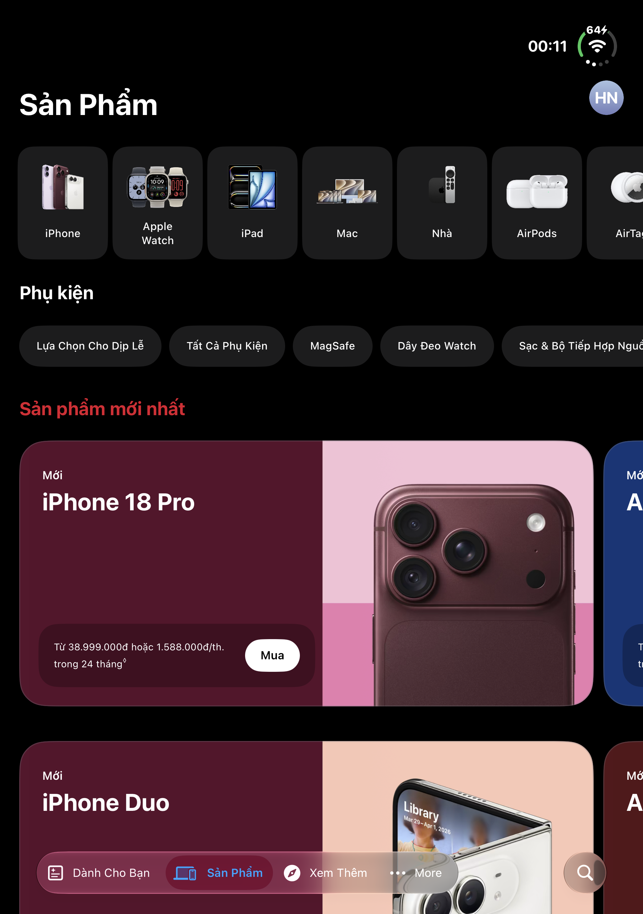

# ForceDuoApp
Force iPhone Duo's application use latest SDK to adaptive and supports iPhone Duo, normally it just fall back to iPad UI

# Story
I actually do it myself on Genshin Impact by using this bug (worse_query) already for a while, [check this](https://x.com/Little_34306/status/2118348221147992214?a=jNEfqdbm-pyJBUv4170)!

Then the bug (worse_query got burned by forcequit, yeah, i also found it on Aug too :P) and I think it's a time to release how to do it and then i saw someone do the app with automatically patch instead of doing it by my deadass old school way, check the original post [here](https://www.reddit.com/r/sideloaded/comments/1xvhqh4/release_experimental_duo_sdk_remove_the_black/)

So this is the release post!
Demo (Apple Store app now support iPhone Duo)!

# Credit
- [worse_query](https://github.com/forcequitOS/worse_query)
- that reddit post guy
- me

# LiveContainer compatibility

Experimental iOS LiveContainer support and IPA build instructions are documented in [LIVEContainer.md](LIVEContainer.md). Device verification is still required.
